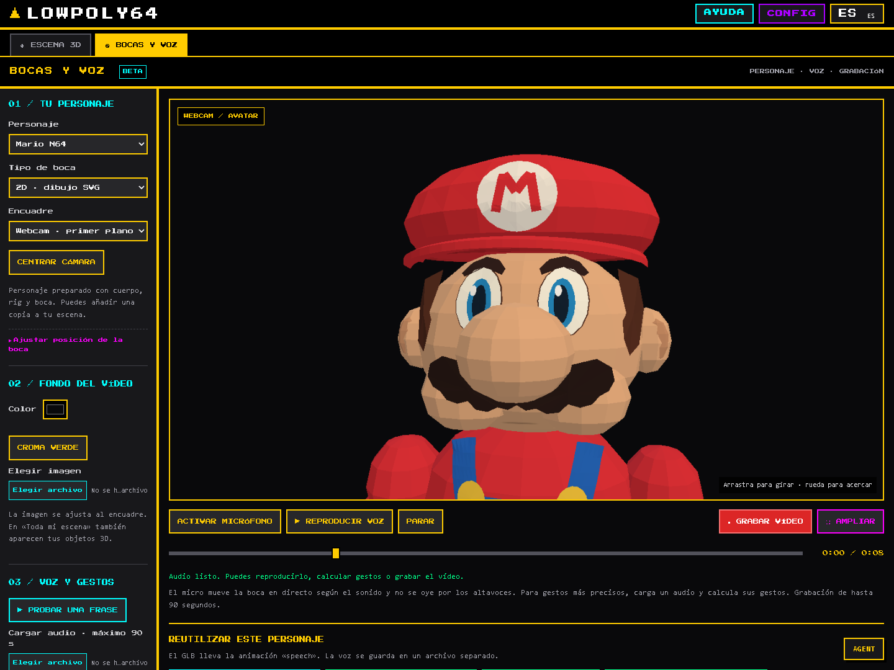

# Retrovisor 3D v0.9.0 — Personajes y voz

Candidata preparada el 8 de septiembre de 2026; integración del estudio de voz ampliada el 9 de septiembre. Pendiente de publicación.

Esta versión reúne cuerpos y cabezas reutilizables, nuevos estudios visuales PSX/N64, animación compatible mediante GLB y **Bocas y voz · beta**. Las recetas siguen siendo editables; los personajes y movimientos se pueden llevar a otros programas mediante GLB.

El catálogo incorpora miniaturas reales de sus **305 modelos** a la derecha de cada entrada. Las imágenes se generan a partir de la geometría del editor y se cargan al recorrer la lista.

## Bocas y voz · beta

Selecciona **Bocas y voz / Speech & voice** junto a **Escena 3D / 3D Scene** bajo la cabecera del editor. Es un espacio de trabajo integrado, sin popup, con bocas SVG, de capas y mandíbula 3D sobre personajes preparados y humanoides compatibles de tu escena. Conserva los ajustes al cambiar de modo; el micro y la reproducción se detienen al volver a Escena 3D.

- Reproduce una frase preparada o carga tu propia grabación.
- Compara abertura por intensidad con gestos automáticos aproximados.
- Cambia de personaje conservando la pista y el tiempo de reproducción.
- Guarda movimientos JSON y exporta un GLB con el personaje y el clip `speech`.
- Usa encuadre webcam, cuerpo completo o toda tu escena, con fondo de color, croma o imagen.
- Graba vídeo con voz y movimientos sincronizados, y guarda una toma completa en ZIP.
- Añade una copia hablada a tu escena con una inserción deshacible.

Las demos, la intensidad y las pistas importadas funcionan también en una web estática. Para calcular gestos de una grabación nueva hace falta el motor opcional Rhubarb y el servicio local. Después de instalar las dependencias del proyecto:

```text
npm run rhubarb:install
npm run dev
```

El audio se procesa en el equipo y se conserva separado del GLB. El micrófono sigue la intensidad en directo y se puede grabar. Las bocas siguen siendo accesorios: permiten ajustar su posición, pero no deforman toda la piel facial ni se adaptan a cualquier GLB. El modo webcam no instala una cámara virtual del sistema; Hocuspocus todavía necesita un importador específico. Rhubarb estima formas, no transcribe ni garantiza sincronía perfecta.

Consulta [el estudio integrado y la reutilización](docs/speech-studio.md), [la guía local](docs/local-lip-sync.md) y [la demostración con tres personajes](docs/speech-characters-video.md).

## Personajes, caras y animaciones

**Character Studio** permite construir un cuerpo PSX/N64, reutilizarlo con otras cabezas y ajustar proporciones, pelo, ropa y equipo. Los estudios de espadachín PSX y fontanero N64 incluyen recetas guardadas; la gorra del personaje N64 tiene copa, visera curva y emblema modelados.

**Avatar Forge** incorpora Nora, Ivo, Mara y Bruno, con doce dibujos de ojos, cejas y bocas reutilizables. Se corrigen anclajes de accesorios, colocación facial, línea del cabello y geometría excesiva en las orejas.

**ANIMAR CON GLB** crea una copia con deformación real a partir del perfil compatible de 24 huesos analizado. Conserva pesos, caras texturizadas y clips al pasar por JSON, GLB y guardado de escena. Nuestros GLB exportados pueden servir como nuevos donantes. El original sigue disponible para editar piezas.

La compatibilidad se refiere a ese perfil concreto; no a cualquier rig de Meshy u otro proveedor. La edición visual avanzada de clips nativos, contacto de pies y rigs faciales completos quedan fuera de esta entrega.

Detalles: [cuerpos reutilizables](docs/reusable-retro-characters.md), [rig compatible](docs/meshy-rig-analysis.md), [caras de Forge](docs/avatar-forge-refresh.md).

## Control mediante LLM

El agente consulta capacidades y recetas, crea borradores aislados, obtiene tres vistas, aplica correcciones acotadas y hace commit en una acción deshacible. Los artefactos PNG, JSON y GLB completos se conservan para descarga. Los conflictos de revisión protegen las modificaciones manuales.

Los adaptadores locales/API comprueban capacidades por modelo. La cobertura de protocolo no certifica calidad visual ni éxito de una conversación real. Una puntuación estructural tampoco demuestra parecido con una referencia.

Consulta [el contrato de personajes](docs/llm-character-control.md) y [los proveedores](docs/agent-providers.md).

## Validación y publicación

La revisión pasó **156 pruebas unitarias**, **43 recorridos críticos** (con la salvedad del donante explicada en el informe) y la compilación. Se repitieron los 14 escenarios de bocas tras la última corrección, y se probó la build local y estática sin errores de página.

La integración del 9 de septiembre añade sus [comprobaciones de captura, reutilización y distribución](docs/speech-studio-verification.md).



El alcance y los resultados exactos de la revisión están en [el informe de la candidata](docs/release-0.9.0-review.md). La revisión manual completa y el vídeo explicativo posterior tienen su [hoja de ruta para Grok](docs/grok-release-review-roadmap.md).

Para repetir las comprobaciones, instala las dependencias con `npm ci` y un navegador con `npx playwright install chromium`; después ejecuta `npm run verify` y `npm run test:e2e`. En Windows también se puede seleccionar Edge mediante `PLAYWRIGHT_EXECUTABLE_PATH`.

El binario opcional de Rhubarb y el GLB donante del usuario no se incluyen en el repositorio ni en la build web. Las pruebas que requieren ese donante necesitan `MESHY_TEST_GLB`.

Esta candidata no crea una etiqueta ni publica una release. El workflow de publicación lee `RELEASE.md` desde la etiqueta seleccionada; no ejecuta las comprobaciones ni adjunta automáticamente una build.
