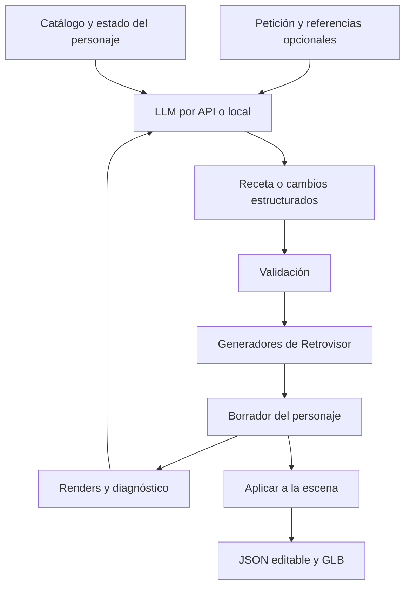

# Plan: crear y editar personajes de Retrovisor mediante un LLM

Fecha: 7 de septiembre de 2026. Propuesta basada en el código presente en este directorio, incluidos los cambios locales en curso. Este documento es un plan; no implementa la integración ni certifica las llamadas a proveedores reales.

**Objetivo**

Poder escribir «hazme un personaje como Cloud de Final Fantasy VII de PSX», obtener un personaje editable en Retrovisor y continuar con «haz la espada más grande», «reduce la cabeza» o «cambia solo el pelo». El resultado debe poder guardarse como JSON, reabrirse y exportarse como GLB manteniendo su jerarquía y animaciones compatibles.

La arquitectura propuesta asigna al LLM las decisiones de diseño y las correcciones. Retrovisor transforma esas decisiones en geometría mediante generadores y comandos validados. La calidad dependerá tanto de la capacidad del modelo como de las formas que podamos expresar con esos generadores.

**1. Punto de partida comprobado**

| Área | Lo que existe | Lo que necesitamos completar |
|---|---|---|
| Control del editor | Panel AGENT, companion Node, puente de navegador y MCP; IDs estables y undo/redo | Operaciones específicas de personajes y una ejecución completa agrupada |
| Proveedores | Adaptadores fijos para OpenAI y xAI, ambos mediante `/responses` | Configuración extensible, proveedor local y detección de capacidades |
| Creación | `import_object_definition` llama al mismo importador que la interfaz | Describir los formatos y parámetros al modelo; validación previa con errores precisos |
| Recetas compactas | Character Studio acepta `retrovisor-character`; Avatar Forge tiene recetas y catálogos propios | Integrar sus capacidades bajo herramientas comunes sin crear un tercer motor geométrico |
| Personajes articulados | CharacterModel, slots, pivotes y cuerpos nuevos con HUMANOID_STANDARD | Conservar esas relaciones durante cambios de proporciones, equipamiento y regeneraciones |
| Catálogo | Plantillas, moldes y presets; ya hay referencias de Cloud | Búsqueda por rasgos, ejemplos pequeños y consulta de parámetros admitidos |
| Observación | `capture_viewport`; script de renders frontal, perfil y tres cuartos | Entrega íntegra de imágenes y capturas del personaje desde vistas controladas |
| Exportación | JSON y GLB en el editor; exportación JSON mediante herramienta | Entregar archivos íntegros, separados de los resúmenes enviados al modelo |

Archivos principales: [catálogo de herramientas](../src/modules/agent/tool-catalog.js), [comandos del editor](../src/modules/agent/agent-command-api.js), [ejecutor del asistente](../server/agent/assistant-runner.js), [proveedores](../server/agent/provider-client.js), [Character Studio](../src/modules/character-studio/character-model.js), [Avatar Forge](../src/modules/avatar/avatar-builder.js) e [importación JSON](../src/modules/viewport/json-import.js).

Hay cambios locales activos en Character Studio, importación, persistencia, exportación y Avatar Forge. La implementación deberá acordar contratos con esos módulos y conservar sus cambios; no conviene desarrollar versiones alternativas de ellos.

**2. Hallazgos que condicionan el plan**

- **Las imágenes se recortan en la respuesta.** `capture_viewport` pasa su base64 por `makeSuccessResult`, que usa `sanitizeForModel` con un máximo de 2.000 caracteres por cadena. Una prueba local con un PNG existente produjo 99.512 caracteres de entrada y 2.000 de salida, con una elipsis final. El ejecutor intenta adjuntar después esa cadena como imagen. Hay que corregir el transporte antes de evaluar la autocorrección visual.
- **Los datos exportados también atraviesan un resumidor.** Este limita profundidad, arrays y cadenas. Sirve para observaciones de contexto, pero una definición destinada a reimportarse debe conservarse íntegra. Debe tener un canal de artefactos distinto del resumen.
- **El modelo recibe instrucciones generales de edición.** El mensaje de sistema actual no explica las recetas, moldes, restricciones del rig ni criterios de diseño de un personaje. `get_application_status` expone IDs de plantillas por categoría, pero no ofrece una búsqueda por rasgos o fichas de presets de Avatar Forge.
- **La receta básica tiene expresividad limitada.** Character Studio permite estilo, dimensiones, colores y pelo `short`, `spiky` o `none`. Avatar Forge ofrece más control facial y de pelo. Una espada ancha, una hombrera asimétrica o un traje específico requieren composición adicional y parámetros apropiados.
- **El bucle actual tiene 8 turnos de proveedor y 16 llamadas a herramientas.** Crear un personaje pieza a pieza agotaría pronto ese presupuesto. Las operaciones deben trabajar sobre cuerpos, cabeza, pelo o equipamiento completos.

La prueba de imágenes comprueba el constructor de respuestas con un PNG real. No equivale a una prueba completa navegador → proveedor. Las pruebas actuales de captura revisan principalmente tipo, prefijo o longitud; la nueva verificación debe decodificar la imagen recibida.

**3. Arquitectura propuesta**



El ciclo tiene límites y condiciones de parada. Un modelo que termina de responder no determina por sí solo que el personaje esté terminado: deben cumplirse las comprobaciones del resultado.

Usar el mismo registro de comandos para el panel y para MCP. El JSON y las llamadas a herramientas son dos entradas al mismo motor: una receta puede importarse manualmente o llegar desde el asistente.

**4. Qué debe producir el LLM**

Separar tres niveles:

1. **Descripción de diseño:** estilo, proporciones, silueta, colores, rasgos distintivos y referencias. Permite comprobar qué entendió el modelo.
2. **Receta ejecutable y cambios:** IDs reales de catálogo, valores dentro de límites y operaciones sobre partes conocidas.
3. **Modelo compilado:** CharacterModel y geometría que genera Retrovisor, con sus pivotes, materiales y relaciones de parentesco.

El formato editable final seguirá apoyándose en los formatos existentes. La descripción de diseño será información del trabajo, no otro formato geométrico que haya que mantener.

Ejemplo de descripción intermedia propuesta para el caso de Cloud; **no es un JSON importable hoy**:

```json
{
  "intentVersion": 1,
  "label": "Espadachín inspirado en Cloud PSX",
  "style": "psx",
  "proportions": "battle",
  "body": { "build": "slim_athletic" },
  "hair": { "shape": "asymmetric_spikes", "color": "#E6C65B" },
  "outfit": { "shape": "sleeveless_uniform", "color": "#514571" },
  "equipment": [
    { "kind": "single_pauldron", "side": "left" },
    { "kind": "broad_sword", "attachTo": "HAND_R" }
  ],
  "mustPreserve": ["articulation", "editable_parts"]
}
```

Un paso posterior resolverá esos términos a capacidades concretas. Si no existe una forma, devolverá una carencia explícita; no elegirá silenciosamente un preset por defecto y dará el objetivo por cumplido.

Para ampliar las formas, empezar por constructores reutilizables: mechones orientables, prendas sobre torso y piernas, hombreras y armas por perfil y dimensiones. Reservar las mallas CUSTOM acotadas para piezas que los generadores no puedan expresar. Mantener un contrato explícito de unidades, ejes, orientación del personaje, grados/radianes y coordenadas locales. «Izquierda» debe referirse al personaje.

**5. Herramientas a exponer**

Estos nombres describen herramientas nuevas propuestas. Reutilizarán los módulos actuales.

| Herramienta | Resultado útil para el modelo |
|---|---|
| `get_character_capabilities` | Formatos, versiones, constructores, parámetros, límites y convenciones |
| `search_character_catalog` | Candidatos filtrados por estilo y rasgos, con IDs y descripciones; paginación |
| `get_character_recipe` | Receta, partes semánticas, IDs y revisión actual del personaje |
| `validate_character_recipe` | Errores por campo, valores aceptados y advertencias antes de modificar la escena |
| `build_character_draft` | Borrador compilado con IDs, medidas, presupuesto y diagnóstico del rig |
| `patch_character_draft` | Cambios por parte: pelo, cabeza, cuerpo, colores o equipamiento |
| `render_character_views` | Frontal, perfil y tres cuartos, con encuadre automático y metadatos de cámara |
| `evaluate_character` | Medidas, triángulos, texturas, jerarquía y problemas comprobables |
| `commit_character_draft` | Inserción o actualización como una acción reversible |
| `export_character_asset` | Archivo completo y resumen; formatos soportados indicados por capacidades |

Las herramientas de edición general actuales siguen siendo útiles para colocar, duplicar y organizar personajes en la escena. Las nuevas herramientas añaden conocimiento sobre su estructura.

No enviar todos los vértices ni todo el catálogo en cada llamada. Entregar fichas relevantes y observaciones compactas; conservar el JSON completo como artefacto. Los resúmenes deben indicar explícitamente si están truncados.

**6. Compatibilidad con API y modelos locales**

Introducir una interfaz común de proveedor con configuración de servicio, modelo, URL y credencial cuando corresponda. El servidor local existente seguirá gestionando las conexiones y credenciales.

| Capacidad del modelo y del servidor | Comportamiento de Retrovisor |
|---|---|
| Herramientas + imágenes | Planificación y corrección visual con el mismo modelo |
| JSON estructurado + imágenes | Recetas y correcciones por JSON; el ejecutor realiza las operaciones |
| Herramientas o JSON, sin visión | Generación y comprobaciones geométricas; revisión visual por el usuario o un revisor compatible elegido explícitamente |
| Sin salida estructurada fiable | Intentos acotados de parseo y reparación; indicar incompatibilidad si no supera la prueba inicial |

Primer objetivo local: un adaptador Ollama y una ruta compatible con LM Studio, con pruebas separadas. No basta con cambiar la URL del adaptador actual: también cambian los formatos de mensajes, imágenes, herramientas, uso y eventos de streaming.

Ollama documenta [salidas estructuradas](https://docs.ollama.com/capabilities/structured-outputs), [herramientas](https://docs.ollama.com/capabilities/tool-calling) e [imágenes para modelos con visión](https://docs.ollama.com/capabilities/vision). LM Studio documenta [salida mediante JSON Schema](https://lmstudio.ai/docs/developer/openai-compat/structured-output). El soporte efectivo deberá comprobarse para cada combinación de servidor y modelo.

La interfaz ofrecerá una prueba de conexión y capacidades antes de generar: JSON de ejemplo, operación inocua y lectura de una imagen de prueba cuando se solicite visión. La elección de modelo concreto queda para una evaluación con el hardware disponible, latencia aceptable y presupuesto. No asumir calidad equivalente entre todos los LLM.

En modo local, mantener inferencia y recursos en el equipo y verificar funcionamiento sin red una vez descargados. Un fallo del servicio local no debe provocar una llamada automática a la nube.

**7. Flujo completo del ejemplo**

1. Leer «hazme un personaje como Cloud de FF7 PSX» y producir una descripción breve de los rasgos que se construirán. Distinguir proporciones de campo y combate; se puede mostrar una elección inicial modificable sin bloquear el primer borrador.
2. Consultar el catálogo y los parámetros. Las referencias de Cloud que ya existen sirven de comparación y prueba del control. También deberá haber una evaluación de construcción usando componentes genéricos, para demostrar que el sistema genera y modifica personajes nuevos.
3. Crear el cuerpo articulado y resolver cabeza, pelo, traje, hombrera y espada. El constructor coloca pivotes y relaciones de parentesco.
4. Validar la receta y compilar en un borrador. Comprobar dimensiones finitas, jerarquía válida, nombres únicos, partes presentes y presupuesto de geometría.
5. Renderizar frontal, perfil y tres cuartos. Revisar cuerpo entero y, si hace falta, un detalle de cabeza. Separar fallos medibles de juicios visuales: que no exista un brazo es verificable; que la silueta recuerde a Cloud requiere evaluación visual.
6. Proponer cambios pequeños y volver a renderizar. Máximo inicial: una generación y hasta tres ciclos de corrección. Conservar el mejor borrador y detenerse si no mejora, se cancela o se alcanza el presupuesto.
7. Aplicar automáticamente las operaciones reversibles autorizadas por la petición, con una acción de deshacer. Ofrecer «solo vista previa» como opción; no exigir confirmación en cada ajuste.
8. Entregar personaje, receta, JSON completo y acceso a exportación GLB. Indicar las limitaciones observadas sin confundir JSON válido con parecido visual logrado.
9. Ante «haz la espada un 20 % más grande», localizar la pieza semántica y conservar su anclaje. Ante «cambia solo el pelo», regenerar esa parte y preservar el resto, incluidas modificaciones manuales.

Si el modelo no ve imágenes, el paso visual quedará marcado como pendiente de revisión. Las métricas no permiten afirmar por sí solas que el parecido está logrado.

**8. Orden de implementación y entregables**

| Fase | Trabajo | Criterio de salida |
|---|---|---|
| 0. Base fiable | Corregir imágenes y separar artefactos completos de resúmenes; comprobar importación actual | PNG decodificable tras recorrer navegador, companion y cliente; JSON exportado reimportable sin pérdida por truncado |
| 1. Primera generación por conversación | Esquema de receta publicado, consulta del catálogo, validación e importación desde el panel existente | Petición de un humanoide PSX produce un modelo articulado editable; una segunda petición modifica el mismo personaje |
| 2. Formas distintivas | Composición de cabeza/cuerpo y constructores de pelo, prendas, hombreras y armas | Construir y variar el caso Cloud con piezas editables; demostrar también un personaje sin plantilla completa preexistente |
| 3. Revisión y corrección | Borradores, capturas múltiples, diagnóstico y ciclos acotados | Detectar y corregir al menos un defecto visual preparado; conservar el mejor resultado y deshacer todo el encargo |
| 4. API y local | Interfaz de proveedores, adaptadores, configuración y prueba de capacidades | Mismo contrato ejecutado con un proveedor API y uno local; comportamiento explícito cuando no hay visión |
| 5. Producto y evaluación | Sesiones recuperables, preservación de cambios manuales, exportación, batería de encargos y medición | Flujo crear → editar → guardar → reabrir → exportar, medido en proveedores reales |

Dependencias: empezar por 0 y 1. La abstracción de proveedores puede prepararse tras definir el contrato de recetas, sin esperar a completar todas las formas. El MVP que satisface la petición completa requiere las fases 0–4; la fase 1 por sí sola es una prueba de concepto.

Primera demostración recomendada: «crea un espadachín PSX con pelo rubio puntiagudo» → «añade una espada ancha» → «haz la cabeza algo más pequeña» → exportar y reimportar. Después evaluar parecido con la referencia y ampliar las formas que falten.

**9. Estado, cambios manuales y recuperación**

Guardar por encargo: petición, decisiones de diseño, receta, versión del generador y catálogo, revisión del objeto, cambios aplicados, renders y resultado de las comprobaciones. Si un generador incorpora aleatoriedad, guardar también la semilla.

La receta describe lo generado; las piezas actuales contienen las modificaciones manuales. Antes de actualizar, comprobar si el usuario ha cambiado el personaje y regenerar solo las partes solicitadas. Conservar IDs de las partes que permanecen y devolver un mapa de sustituciones cuando cambien.

Aplicar los borradores como transacciones con revisión esperada del objeto, identificador de operación y undo/redo. Una respuesta tardía o un reintento no debe duplicar el personaje ni sobrescribir cambios posteriores. La cancelación descarta el borrador pendiente y conserva el estado ya confirmado.

**10. Cómo sabremos si funciona**

Preparar una batería inicial de 12 encargos: tres basados en referencias, tres personajes originales, tres ediciones sobre modelos existentes y tres casos de error o recuperación. Repetir las pruebas de generación para observar variación; registrar configuración del modelo y hardware local.

Medir por separado:

- **Validez técnica:** receta aceptada, partes y rig presentes, importación/exportación sin pérdidas, edición selectiva y undo/redo correctos. Todos los casos funcionales deterministas deberán pasar.
- **Cumplimiento visual:** rasgos distintivos, proporciones, silueta, paleta y consistencia entre vistas. Comparación humana con rúbrica de 1–5; objetivo inicial propuesto de al menos 4 en los rasgos prioritarios. La opinión del propio LLM será una ayuda, no la única medida.
- **Generalización:** resolver los casos originales usando componentes y demostrar que los casos de referencia no dependen exclusivamente de cargar un modelo completo ya existente.
- **Coste y tiempo:** duración, llamadas, intentos, tokens cuando el servidor los informe, correcciones e intervención humana. Mostrar consumo desconocido como desconocido; coste estimado separado del dato del proveedor.
- **Comportamiento ante fallos:** preset inexistente, JSON inválido, límite de geometría, imagen defectuosa, modelo sin visión, desconexión local, cancelación y edición manual simultánea.

Pruebas de implementación previstas: ampliar `test:agent`, `test:mcp` y la integración del navegador; cubrir el formato de personaje y roundtrip JSON/GLB; añadir renders comparables y pruebas pequeñas con proveedores reales configurados. Los mocks prueban el transporte y los comandos, pero no la capacidad artística del modelo.

La principal incertidumbre será el parecido visual conseguido dentro del presupuesto geométrico. El primer ciclo debe medirlo pronto y permitir ampliar los constructores donde el lenguaje actual del editor se quede corto.
