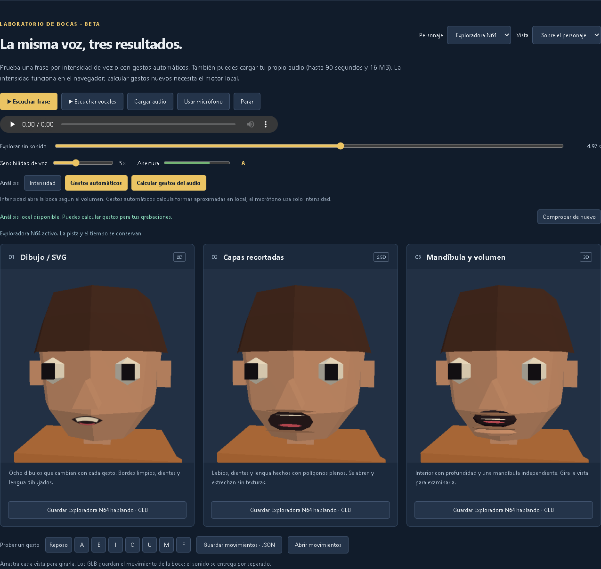

# Revisión final de la candidata 0.9.0

Fecha: 8 de septiembre de 2026. Entorno: Windows, Node 24.15.0, npm 11.7.0 y Edge con WebGL. Revisión técnica de los últimos cambios y de recorridos críticos; la revisión manual completa y el vídeo posterior quedan en [el encargo para Grok](grok-release-review-roadmap.md).

## Decisión

Preparar **0.9.0 — Personajes y voz**, con **Bocas y voz · beta** como novedad destacada. El laboratorio ya ofrece un recorrido concreto: elegir personaje, escuchar/cargar audio, comparar tres bocas, guardar movimientos y exportar el personaje hablando.

La versión y su lock están sincronizados en 0.9.0. [RELEASE.md](../RELEASE.md) y [CHANGELOG.md](../CHANGELOG.md) describen la candidata. Las notas publicadas de 0.8.0 se conservan [en su carpeta](releases/v0.8.0/RELEASE.md). No se ha creado etiqueta, commit de release ni publicación remota.

## Correcciones de esta pasada

- **Acceso al laboratorio:** enlace directo BOCAS Y VOZ · BETA en el panel izquierdo, con traducción al inglés; entrada y pasos en la ayuda bilingüe.
- **Disponibilidad del motor:** estado visible de análisis local listo, instalación pendiente o servicio ausente; instrucciones y botón para comprobar de nuevo. Una web estática no habilita el cálculo de grabaciones nuevas; conserva demos, intensidad y exportación.
- **Arranque del agente:** `agent:dev` y los origins exactos del companion usan el puerto 5176 del editor. Se conservan los overrides para instalaciones y pruebas con otros puertos.
- **Pistas automáticas guardadas:** el JSON conserva origen Rhubarb, reconocedor y formas originales; reabrirlo mantiene Gestos automáticos, conserva la animación y separa el audio anterior. Se validan metadatos y se mantiene compatibilidad con pistas antiguas.
- **Documentación:** README refleja los dominios actuales, 299 plantillas auditadas, personajes, rigs, bocas, dependencias opcionales y configuración del navegador de pruebas.

## Evidencia

Los registros detallados se guardan localmente en `artifacts/release-review/`. Los fallos iniciales se conservan para distinguir los problemas del entorno de los resultados posteriores.

| Comprobación | Resultado |
| --- | --- |
| Batería unitaria final | **156 correctas**, incluyendo defaults/overrides del agente y procedencia, compatibilidad y validación de pistas de voz. |
| Datos del editor | 6 moldes corporales, 9 esqueletos, 38 clips, 192 sprites y 299 plantillas validados; cabezas generadas y ejemplos de personaje correctos. |
| Auditoría visual | 8 casos de cabeza/personaje y 6 moldes; 28 capturas, sin fallo de auditoría. |
| Recorridos críticos de navegador | 39 correctos en la primera pasada. Otros 4 fallaron al intentar abrir un archivo de prueba que ya no existe en su ruta original. |
| Rig con un GLB exportado por Retrovisor | Los 4 recorridos afectados pasan usando un donante exportado previamente: Forge, PSX, N64, JSON/GLB/escena, redonación, Undo/Redo y error de archivo corrupto. Total: 43 recorridos críticos comprobados. |
| Regresión final de bocas | **14 escenarios correctos**, repetidos tras el ajuste del JSON: audio real analizado, tres personajes/modos, exportación/reimportación, cancelación, permiso de micrófono denegado y servicio ausente. Son parte de los 43 recorridos, no 14 recorridos únicos adicionales. |
| Build distribuible | Compilación correcta. Probada con Vite preview y con servidor estático sin API: inicio silencioso, tres personajes, 54 gestos preparados, exportación GLB con 14 clips, acceso lateral y ayuda ES/EN. Sin errores de página. |
| ZIP web de la candidata | 120 archivos de la build, 9.286.227 bytes, CRC correcto; manifiesto y checksum SHA-256 disponibles junto al ZIP. |
| Paquete Mario/voz existente | CRC y 51 hashes correctos; 13 clips en Mario base y 14 en las variantes habladas; receta de Cloud intacta. |

El primer `npm run verify` se detuvo al iniciar la auditoría visual porque no estaba instalado el Chromium gestionado por Playwright. Se repitió esa fase con Edge instalado y pasó. Es una precondición del entorno: el README ahora explica instalar Chromium o elegir el navegador.

El donante adjunto original, `Meshy_AI_Meshy_Merged_Animations.glb`, ya no se encuentra en la ruta facilitada. La repetición usa `artifacts/release-review/previous-export-donor.glb`, copia de nuestro N64 exportado con SHA-256 `3a009ee8e4a62d564823911b598c6d563c1c4ccbb481a9b866185ed856a97b1e`. Demuestra el recorrido de reutilización de nuestros GLB; **no es una repetición actual de la importación del adjunto original**. Las pruebas anteriores de ese adjunto están descritas en [el análisis del rig](meshy-rig-analysis.md).

Para repetir la prueba de la build: `npm run build` y `node scripts/check-speech-build.mjs`, con `PLAYWRIGHT_EXECUTABLE_PATH` si se usa Edge. Informe: `artifacts/release-review/production-static-verification.json`. Paquete: `artifacts/release-review/retrovisor-0.9.0-web.zip`.

## Límites que acompañan a la candidata

- El lip sync es aproximado. Hay tres personajes preparados y tres bocas accesorias; no hay ajuste universal a GLB ajenos ni deformación facial completa.
- El GLB conserva movimientos, con sonido separado. La ampliación del 9 de septiembre añade grabación del micro, vídeo y ZIP portátil en el estudio integrado; véase [uso y límites](speech-studio.md). Los resultados de la tabla anterior corresponden a la revisión previa.
- Rhubarb para grabaciones nuevas requiere servicio local y motor instalado. La web estática conserva los recorridos preparados y la intensidad.
- La animación por donante cubre el perfil analizado de 24 huesos. No certifica todos los Meshy, la edición visual avanzada de clips nativos ni el contacto de pies.
- Proveedores LLM reales, micrófono/permisos en distintos navegadores, instalación macOS/Linux y Motion Ripper completo quedan para la matriz manual de Grok. Los tests de protocolo o dobles de prueba no se presentan como esas validaciones reales.

## Seguimiento técnico sin bloqueo del recorrido Windows

- La build avisa de un bloque compartido de aproximadamente 1.135 kB minificado (343 kB gzip). Conviene medir arranque en un equipo modesto y separar carga de funciones; no se ha ocultado el aviso subiendo el umbral.
- El instalador no comprueba plataforma/versión de un manifiesto copiado desde otro sistema. No se han validado instalaciones trasladadas: instalar de nuevo para la plataforma de destino; revisar ese caso antes de anunciar instaladores multiplataforma.
- El servicio espera el cierre del proceso al cancelar. La limpieza está probada con Rhubarb real; falta endurecer el caso excepcional de un proceso que no cierre tras la señal de terminación.

## Publicación posterior

Antes de etiquetar, revisar los nuevos archivos que aún no están versionados, crear el commit de entrega y comprobar ese estado exacto. No incluir ejecutables locales, archivos temporales, credenciales ni el donante del usuario. El workflow actual publica notas desde `RELEASE.md` en la etiqueta; no compila, no prueba y no adjunta automáticamente la build web. Subir solo `main` no crea una versión nueva.

Grok tiene instrucciones para completar la matriz de la app, informar los casos no probados, resolver los fallos que bloqueen el uso y grabar después el recorrido explicado en español. El vídeo y la revisión completa no se han ejecutado como parte de esta última pasada.
